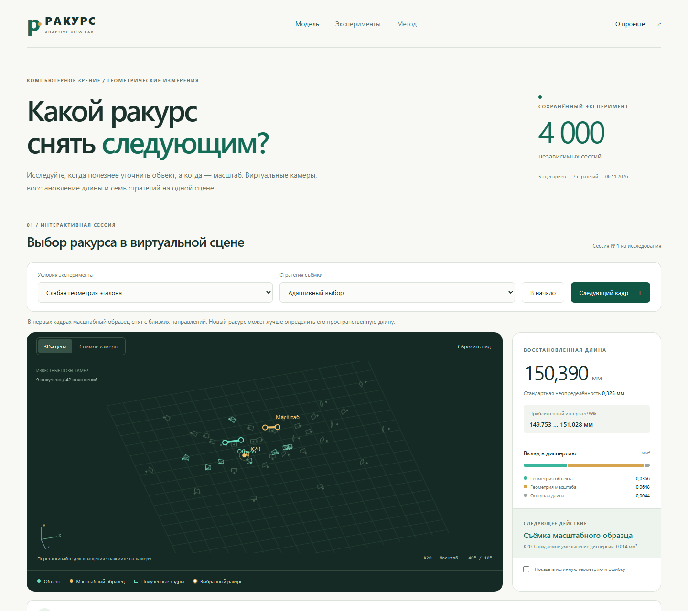

<div align="center">

# Ракурс
### Adaptive View Lab

**Интерактивная лаборатория выбора ракурсов для геометрических измерений**

3D-сцена · семь стратегий · воспроизводимые вычисления

[Быстрый запуск](#быстрый-запуск) · [Что можно исследовать](#что-можно-исследовать) · [Результаты](docs/results.md) · [Математика](docs/method.md) · [GitHub Pages](docs/github-pages.md)



</div>

## Задача

При измерении длины по изображениям дополнительный снимок объекта и уточнение масштаба могут дать разную пользу. Проект позволяет исследовать этот выбор: восстановить два пространственных отрезка из зашумлённых проекций, оценить неопределённость длины и выбрать следующее наблюдение.

**Статус:** исследовательский прототип 0.1.0. Это моделирование координат изображений при известных позах камер. Распознавание точек на фотографиях смартфона и полная фотограмметрическая реконструкция в проект не входят.

## Быстрый запуск

1. Скачайте проект целиком и распакуйте архив.
2. Откройте **`index.html`** в Chrome, Edge или Firefox.
3. Выберите условия и нажимайте **«Следующий кадр»**. Перетаскивайте сцену для вращения, используйте колёсико для масштаба.

Для веб-модели **не нужны установка пакетов, Python, интернет или сервер**. Все необходимые файлы находятся в папке проекта. Переносить один `index.html` без папки `assets` нельзя.

Необязательный локальный сервер, если установлен Node.js:

```sh
npm run preview
```

Адрес будет напечатан в терминале. Сборка и `npm install` не требуются.

## Что можно исследовать

- **3D-сцена:** камеры, восстановленные отрезки и положение следующего наблюдения. Камеры можно выбирать для просмотра.
- **Виртуальный снимок:** зашумлённые проекции концов отрезков в выбранной камере.
- **Пошаговое измерение:** шесть начальных кадров и восемь дополнительных действий.
- **Бюджет неопределённости:** геометрия объекта, геометрия масштабного образца и его внешняя опорная длина.
- **Семь стратегий:** адаптация, первоначальный план, чередование, регулярная пересъёмка образца, случайный выбор и два ограничения на группы камер.
- **Честное сравнение:** переключение стратегии сохраняет тот же банк наблюдений.
- **Новые реализации шума:** повторяемый браузерный генератор и экспорт полной сессии в JSON.
- **Сохранённое исследование:** результаты 4000 независимых сессий, таблицы ошибок и проверка покрытия интервалов.

Истинные точки можно открыть для визуальной проверки. Они не участвуют в выборе действия. Предпросмотр будущего виртуального кадра доступен зрителю, но его координаты не передаются селектору до добавления кадра.

## Сценарии

| Сценарий | Что проверяется |
| --- | --- |
| Слабая геометрия эталона | Польза разнесённых направлений наблюдения масштаба |
| Слабая геометрия объекта | Уточнение пространственного отрезка объекта |
| Устойчивая начальная геометрия | Нужна ли адаптация после хорошего начального набора |
| Неточная длина эталона | Предел, который не устраняется фотографированием |
| Шум выше прогноза вдвое | Достоверность расчётных интервалов при ошибке модели |

## Выполненное исследование

В пяти сценариях проведено по **800 независимых повторений**. Семь стратегий использовали общие банки наблюдений внутри повторения. Получено 28000 траекторий стратегий на 4000 независимых сессиях, а не 28000 независимых испытаний.

В сценарии слабой геометрии масштабного образца:

| Стратегия | RMSE, мм |
| --- | ---: |
| Ракурсы вокруг объекта | 0,332 |
| Эталон каждый третий | 0,263 |
| Чередование 1 к 1 | 0,249 |
| План по первым кадрам | 0,244 |
| Адаптивный выбор | 0,248 |

Адаптивная стратегия снизила RMSE примерно на 25% относительно ракурсов вокруг объекта. **Преимущество перед сильным первоначальным планом не установлено.** При фактическом шуме вдвое выше принятого покрытие номинальных 95-процентных интервалов составило 67%.

Сводка в интерфейсе загружается из сохранённого исследования и не меняется при создании новой браузерной сессии. Браузерный генератор использует Mulberry32 и преобразование Бокса Мюллера, исходный опыт — NumPy `default_rng`. Одинаковое число seed у этих генераторов не означает одинаковые наблюдения.

Полные условия, парные интервалы и ограничения: [результаты исследования](docs/results.md). Все 35 сочетаний сценария и стратегии: [summary.csv](data/published/summary.csv).

## Проверки

Для проверки JavaScript нужен Node.js 20 или новее:

```sh
npm test
```

Тесты сверяют 315 состояний браузерной модели с исходным Python-расчётом: выбранные действия, восстановленные длины и стандартные неопределённости. Дополнительно проверяются якобиан, восстановление без шума, воспроизводимость и отсутствие влияния опорной истины на выбор.

GitHub Actions настроен на запуск численных проверок после загрузки репозитория. Локальные проверки выполнены; запуск workflow на вашем GitHub произойдёт после публикации.

## Повторение компьютерных экспериментов

Нужны Python 3.12 и NumPy. В исследовании использован NumPy 2.3.5.

```sh
python -m pip install -r research/requirements.txt
python research/run_experiments.py --trials 800 --out runs/reproduction
python research/check_covariance.py --out runs/reproduction
```

Исходный `research/run_experiments.py` сохранён без изменений относительно выполненного опыта. Контрольная сумма проверяется тестом. Полные банки NPZ и 252000 строк траекторий генерируются в `runs/`; они не нужны для работы сайта и исключены из Git.

Чтобы обновить веб-данные из повторённого запуска:

```sh
python scripts/export_web_data.py --results runs/reproduction
npm test
```

Экспорт перезапишет компактную сводку и контрольные сессии. Для обновления оформленных статических документов и README при новых результатах потребуется отдельно обновить их численные выводы. Не смешивайте опубликованную сводку и результаты другого запуска без фиксации происхождения данных.

## Реальные эксперименты

[Лабораторная инструкция](docs/real-experiments.md) описывает первый пилот: один предмет, отдельный масштабный образец, независимые измерения и две сессии по 24 фотографии. [Пустые журналы](docs/templates/) предназначены для фактически полученных данных. Реальных фотографий и лабораторных результатов в репозитории пока нет.

## Структура

```text
index.html                 интерфейс, открывается без сервера
assets/model.js            численная модель JavaScript без DOM
assets/renderer.js         сцена и графики
assets/app.js              управление сессией
assets/research-data.js    компактные данные выполненного опыта
research/                  исходная Python-модель
data/published/            сводки, настройки и происхождение данных
tests/                     численные проверки и эталонные случаи
scripts/                   экспорт данных и локальный сервер
docs/                      методика, результаты и реальная съёмка
.github/workflows/         автоматические проверки
```

## Размещение

Проект готов к GitHub Pages из корня ветки. Загрузка и включение сайта описаны [здесь](docs/github-pages.md). Аккаунт GitHub, имя репозитория и будущий адрес сайта в файлах не подставлены. Ничего не опубликовано автоматически.

## Автор и статус

Т. А. Галаветдинов, Уральский государственный горный университет.

Версия 0.1.0, подготовлена 6 ноября 2026 года. Для ссылки на программный прототип предусмотрен `CITATION.cff`. Это не DOI и не опубликованная журнальная статья. Лицензия на распространение пока не выбрана (`UNLICENSED`).
